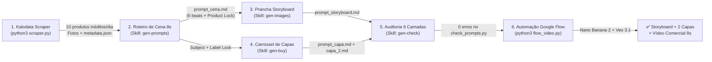

<div align="center">

# 🎬 Extra Income — Pipeline Autônomo de Vídeos UGC & Carrosséis (TikTok Shop)

**Automação ponta a ponta de inteligência de mercado (Kalodata), Engenharia de Prompts Multimodal com Agentes de IA (Google Antigravity) e Geração Automatizada de Mídia (Google Flow — Nano Banana 2 & Veo 3.1 Quality).**

[-6C47FF?style=for-the-badge&logo=github)](https://github.com/messias-code)
[](mailto:codeverso.academy@gmail.com)
[](https://www.python.org/)
[](https://playwright.dev/)
[-4285F4?style=for-the-badge&logo=google&logoColor=white)](#)
[](#)

---

*Projeto concebido, arquitetado e desenvolvido por **[Messias (`@messias-code`)](https://github.com/messias-code)** — **Codeverso Academy**.*

</div>

---

## 📌 Sumário

1. [Visão Geral do Projeto](#-1-visão-geral-do-projeto)
2. [Arquitetura e Diferenciais de Engenharia](#-2-arquitetura-e-diferenciais-de-engenharia)
3. [Como Preparar o Ambiente (Guia para Iniciantes)](#️-3-como-preparar-o-ambiente-guia-para-iniciantes)
4. [Como Configurar e Usar o SEU Próprio Login e Senha](#-4-como-configurar-e-usar-o-seu-próprio-login-e-senha)
5. [Como Pedir para o Antigravity (`agy`) Carregar as Skills](#-5-como-pedir-para-o-antigravity-agy-carregar-as-skills)
6. [Qual a Melhor Ordem e O Que Cada Comando Faz](#-6-qual-a-melhor-ordem-e-o-que-cada-comando-faz)
7. [Detalhamento Passo a Passo de Cada Comando](#-7-detalhamento-passo-a-passo-de-cada-comando)
8. [Estrutura de Pastas e Arquivos](#-8-estrutura-de-pastas-e-arquivos)
9. [Autoria, Créditos e Mérito Técnico](#-9-autoria-créditos-e-mérito-técnico)

---

## 🎯 1. Visão Geral do Projeto

O **Extra Income** é uma esteira completa de automação e direção criativa assistida por IA para vendas no **TikTok Shop** e **Instagram**.

Ele resolve do início ao fim o maior gargalo de quem produz conteúdo de afiliados em escala: **encontrar produtos vencedores todos os dias e transformá-los em vídeos comerciais realistas (sem deformações de IA) e carrosséis de alta conversão.**

Ao final de cada execução diária, o projeto entrega automaticamente para cada um dos **10 produtos inéditos do dia**:
1. **Insumos Reais do Anúncio:** Fotos originais em alta resolução (`capa.jpg`, `imagem_1.jpg`...) + métricas reais do mercado (`metadata.json` com faturamento, vendas, preço e taxa de comissão).
2. **Pacote de 4 Prompts Auditados (`prompt_video/`):**
   - `prompt_cena.md` + `raciocinio.md` — Direção técnica de **1 clipe contínuo de 8s** dividido em **6 beats cronometrados** para o **Veo 3.1 - Quality**.
   - `prompt_storyboard.md` — Prancha vertical (9:16) de **6 painéis numerados** (1 por beat) que serve como mapa visual e trava de identidade do produto no gerador de vídeo.
   - `prompt_capa.md` e `prompt_capa_2.md` — Carrossel de 2 imagens para feed (4:5 gerado em tela 3:4), nas famílias *Brand Editorial* ou *Lifestyle Scrapbook*.
   - `revisao.md` — Laudo de auditoria em 6 camadas garantindo fidelidade visual, ortografia em português e ausência de deformações físicas.
3. **Renderização Automatizada no Google Flow (`flow_video.py`):** Upload das fotos e geração sequencial do storyboard, das 2 capas e do vídeo final de 8s diretamente na conta Google do usuário.

---

## 🧠 2. Arquitetura e Diferenciais de Engenharia



Este projeto foi desenhado por **Messias (`@messias-code`)** com soluções de engenharia específicas para contornar limitações reais de plataformas de dados e modelos generativos de vídeo:

- **Paginação Reversa por Cascata de Filtros (`scraper.py`):** Contas gratuitas da Kalodata bloqueiam a paginação a partir da página 2. O scraper contorna essa trava variando a busca em 6 faixas de comissão e fazendo **rodízio automático entre múltiplas contas** sem perder o progresso do dia.
- **Sistema *Product Lock* e Escada de Risco Físico (N1/N2/N3):** Evita que o gerador de vídeo mude a cor do produto, embaralhe letras da marca ou crie deformações nas mãos. Cada beat descreve um evento físico real e repete literalmente o token de identidade do produto.
- **Storyboard como Único Ingrediente do Vídeo:** O Veo 3.1 não recebe fotos soltas de catálogo; ele recebe a **prancha de 6 painéis** gerada pelo Nano Banana 2 a partir das fotos reais, garantindo continuidade de cenário, iluminação e escala do segundo `0s` ao `8s`.
- **Validador Determinístico (`check_prompts.py`):** Um compilador de regras que analisa dezenas de invariantes estruturais, contagem de palavras, presença de *negative prompts* obrigatórios, costura entre arquivos e distribuição de arcos de câmera no lote.

---

## 🛠️ 3. Como Preparar o Ambiente (Guia para Iniciantes)

Mesmo que você nunca tenha programado antes, basta seguir os 4 passos abaixo no seu terminal Linux/macOS (ou WSL no Windows):

### Passo 3.1 — Clonar o repositório e entrar na pasta
```bash
git clone git@github.com:messias-code/extra_income.git
cd extra_income
```

### Passo 3.2 — Executar o instalador automático
Rode o script de preparação:
```bash
./start.sh setup
```
**O que esse comando faz automaticamente por você:**
1. Cria o arquivo `.env` a partir do modelo `.env.example`.
2. Cria um ambiente virtual isolado do Python na pasta `venv/`.
3. Instala todas as dependências do arquivo `requirements.txt`.
4. Baixa o navegador **Chromium** gerenciado pelo Playwright.

### Passo 3.3 — Ativar o ambiente virtual Python
**Importante:** Toda vez que você abrir uma nova janela do terminal para rodar qualquer comando `python3 ...`, ative antes o ambiente virtual com:
```bash
source venv/bin/activate
```
*(Você verá `(venv)` aparecer no início da linha do seu terminal).*

### Passo 3.4 — Criar o projeto no seu Google Flow (Apenas na 1ª vez)
Para que o robô final (`flow_video.py`) saiba onde guardar os vídeos gerados:
1. Acesse [https://flow.google.com/](https://flow.google.com/) no navegador usando **a sua própria conta Google**.
2. Clique em **Novo projeto** e dê a ele o nome exato: **`renda extra`** (tudo em minúsculas).

---

## 🔐 4. Como Configurar e Usar o SEU Próprio Login e Senha

> [!IMPORTANT]
> **Cada pessoa deve usar exclusivamente o seu próprio login e senha.**
> Nunca utilize as credenciais do autor do projeto nem reaproveite sessões de navegador de terceiros. O sistema possui travas que isolam o arquivo `.env` e limpam a sessão `.flow_profile/` sempre que a conta é alterada.

Você pode configurar o **seu login e senha** (tanto da **Kalodata** quanto do **Google Flow**) de **3 formas diferentes**:

### ✅ Forma 1: Usando o Assistente Interativo (Mais fácil e recomendada)
No terminal, execute:
```bash
./start.sh login
```
O assistente vai perguntar na tela:
1. **Seu(s) e-mail(s) da Kalodata:** Você pode digitar 1 e-mail (ex: `voce@gmail.com`) ou vários separados por vírgula (ex: `conta1@gmail.com,conta2@gmail.com`) para somar o limite diário gratuito de visitas.
2. **Sua senha da Kalodata.**
3. **Seu e-mail e senha da conta Google** (que tem acesso ao Google Flow).

Ao confirmar, o `./start.sh login` grava o seu `.env` com permissão restrita (`chmod 600`) e **remove qualquer pasta `.flow_profile/` antiga**, garantindo que o navegador abra na sua conta.

---

### ✅ Forma 2: Passando `--login` e `--senha` direto no comando do terminal
Se não quiser salvar suas senhas no arquivo `.env`, passe suas credenciais diretamente ao chamar os scripts:

- **Para extrair produtos na Kalodata com a sua conta:**
  ```bash
  python3 scraper.py --login "seu_email@gmail.com" --senha "sua_senha_kalodata"
  ```
  *(Se tiver duas contas na Kalodata com a mesma senha: `--login "conta1@gmail.com,conta2@gmail.com"`).*

- **Para gerar as imagens e vídeos no Google Flow com a sua conta:**
  ```bash
  python3 flow_video.py --login "seu_email_google@gmail.com" --senha "sua_senha_google" --trocar-conta
  ```
  *(A opção `--trocar-conta` apaga qualquer login anterior salvo no navegador antes de entrar com o seu e-mail).*

---

### ✅ Forma 3: Editando o arquivo `.env` manualmente
Abra o arquivo `.env` na raiz do projeto em qualquer editor de texto e preencha com os seus dados reais:
```env
KALODATA_LOGINS=seu_email_kalodata@gmail.com
KALODATA_PASSWORD=sua_senha_kalodata_aqui

GOOGLE_LOGIN=seu_email_google@gmail.com
GOOGLE_PASSWORD=sua_senha_google_aqui
```
*(Sempre que o `GOOGLE_LOGIN` é alterado no `.env`, o `flow_video.py` detecta que o e-mail mudou em relação ao `.flow_profile/.conta_ativa`, limpa o perfil antigo sozinho e faz login na nova conta).*

---

## 🤖 5. Como Pedir para o Antigravity (`agy`) Carregar as Skills

Toda a inteligência de criação de roteiros, storyboards, capas e auditoria mora nas **5 Skills customizadas** dentro de `.agents/skills/`. Quem executa essas skills é o agente **Antigravity (`agy`)**.

### Passo 5.1 — Abrir o `agy` sempre na pasta raiz do projeto
No terminal, certifique-se de estar dentro da pasta do projeto antes de iniciar o `agy`:
```bash
cd /caminho/para/extra_income
agy
```
Quando você abre o `agy` na raiz do projeto, ele lê automaticamente o arquivo `AGENTS.md` e registra as 5 skills do repositório:
- `gen-all` → `.agents/skills/gen-all/SKILL.md`
- `gen-prompts` → `.agents/skills/gen-prompts/SKILL.md`
- `gen-images` → `.agents/skills/gen-images/SKILL.md`
- `gen-buy` → `.agents/skills/gen-buy/SKILL.md`
- `gen-check` → `.agents/skills/gen-check/SKILL.md`

### Passo 5.2 — Como digitar o comando no chat do `agy` (Atenção à barra `/`)
> [!TIP]
> No terminal interativo do `agy`, começar uma linha com `/` (como `/start_gen_all`) faz o terminal procurar um comando interno da própria ferramenta (como `/help` ou `/quit`).
> **Para acionar as skills do projeto sem erro**, digite o comando **sem a barra inicial** ou **peça em português dizendo qual skill carregar**.

### 📋 Mensagens prontas (Copie e Cole no chat do `agy`)

Basta copiar e colar qualquer uma das frases abaixo no chat do `agy`:

| Objetivo | O que copiar e colar no chat do `agy` |
| :--- | :--- |
| **Rodar TUDO de uma vez (Recomendado)** | `Carregue a skill gen-all e execute o start_gen_all para processar todos os produtos pendentes.` |
| **Gerar só os Roteiros de Vídeo (8s)** | `Carregue a skill gen-prompts e execute o start_gen_prompts.` |
| **Gerar só os Storyboards (6 painéis)** | `Carregue a skill gen-images e execute o start_gen_image.` |
| **Gerar só as Capas do Carrossel** | `Carregue a skill gen-buy e execute o start_gen_buy.` |
| **Fazer a Revisão e Auditoria Final** | `Carregue a skill gen-check e execute o prompt_gen_check.` |

---

## 📊 6. Qual a Melhor Ordem e O Que Cada Comando Faz

Abaixo está a **ordem exata e obrigatória** do fluxo de trabalho. Cada etapa usa os arquivos gerados pela etapa imediatamente anterior:

| Ordem | Onde Roda | Comando / Skill | O Que Faz | Saída Gerada |
| :---: | :---: | :--- | :--- | :--- |
| **0º** | Terminal | `./start.sh setup`<br/>`./start.sh login` | Prepara o ambiente virtual, instala o Chromium e configura **seu** login e senha pessoal. | `venv/` e `.env` |
| **1º** | Terminal | `python3 scraper.py` | Faz login na Kalodata e baixa as fotos e métricas de **10 produtos inéditos** do dia. | `produtos/<AAAA-MM-DD>/<NN Produto>/` (`capa.jpg`, `imagem_N.jpg`, `metadata.json`) |
| **2º** | Chat `agy` | **`start_gen_prompts`**<br/>*(Skill `gen-prompts`)* | Lê as fotos reais de cada produto e cria o prompt do vídeo de 8s dividido em 6 beats. | `prompt_video/prompt_cena.md`<br/>`prompt_video/raciocinio.md` |
| **3º** | Chat `agy` | **`start_gen_image`**<br/>*(Skill `gen-images`)* | Lê o `prompt_cena.md` e cria o prompt da prancha de storyboard com 6 painéis (9:16). | `prompt_video/prompt_storyboard.md` |
| **4º** | Chat `agy` | **`start_gen_buy`**<br/>*(Skill `gen-buy`)* | Cria os prompts das 2 imagens de capa do carrossel (capa principal + slide 2). | `prompt_video/prompt_capa.md`<br/>`prompt_video/prompt_capa_2.md` |
| **5º** | Chat `agy` | **`prompt_gen_check`**<br/>*(Skill `gen-check`)* | Audita os prompts contra as fotos reais, corrige erros de física/português e gera o laudo. | Prompts corrigidos +<br/>`prompt_video/revisao.md` |
| **6º** | Terminal | `python3 check_prompts.py check` | Verifica automaticamente se nenhum arquivo ficou faltando e se há `0 erros` nas regras. | Relatório de validação no terminal |
| **7º** | Terminal | `python3 flow_video.py` | Abre o Google Flow na sua conta, sobe as fotos e gera: **Storyboard -> Capa 1 -> Capa 2 -> Vídeo 8s**. | Coleções `produto N` prontas no Google Flow |

### ⚡ Qual é o melhor jeito de rodar no dia a dia?

Você tem dois modos de trabalhar:

1. **Modo Automático (Recomendado para o dia a dia):**
   - **Passo 1 (no terminal):** Rode `source venv/bin/activate && python3 scraper.py` para baixar os 10 produtos do dia.
   - **Passo 2 (no chat do `agy`):** Envie `Carregue a skill gen-all e execute o start_gen_all`.
   - Pronto! A skill `gen-all` executa sozinha as etapas **2º, 3º, 4º, 5º, 6º e 7º** em sequência, validando tudo com `check_prompts.py` e disparando o `flow_video.py` ao final.

2. **Modo Passo a Passo (Para inspecionar cada etapa):**
   - Rode `python3 scraper.py` no terminal e depois acione cada skill individualmente no `agy` na ordem da tabela acima (`start_gen_prompts` → `start_gen_image` → `start_gen_buy` → `prompt_gen_check`), finalizando com `python3 flow_video.py` no terminal.

---

## 🔍 7. Detalhamento Passo a Passo de Cada Comando

### Etapa 1 — Extração de Produtos (`python3 scraper.py`)
```bash
source venv/bin/activate
python3 scraper.py
```
- **Meta diária (`META_DIARIA = 10`):** O script busca terminar o dia com 10 produtos novos. Se você rodar uma segunda vez no mesmo dia e já houver 4 pastas em `produtos/<hoje>/`, ele buscará apenas os 6 restantes.
- **Deduplicação Global (`extracted_products.txt`):** Antes de baixar qualquer produto, confere o histórico completo para nunca repetir um produto já trabalhado em dias anteriores.
- **Cascata de Fontes por Comissão:** Como contas gratuitas (*Prova*) na Kalodata só enxergam a página 1 (10 linhas), o script varia a busca aplicando filtros de comissão em cascata:
  1. Top 10 geral (sem filtro)
  2. Comissão `15% ~ 20%`
  3. Comissão `20% ~ 30%`
  4. Comissão `>30%`
  5. Comissão `10% ~ 15%`
  6. Comissão `<10%`
- **Bypass de Modal e Rodízio de Contas:** Fecha automaticamente o modal *"Dicas de segurança da conta"* com `Escape` antes de cada clique e, se a Conta 1 atingir o limite diário de 10 visitas, troca imediatamente para a Conta 2 configurada no `.env`.

---

### Etapa 2 — Roteiro da Cena de 8s (`start_gen_prompts` / Skill `gen-prompts`)
Regido pelo arquivo `prompt_sistema.yaml`:
- **Take Único de 8s em 6 Beats:** Cria um clipe contínuo vertical (9:16, 720p, 24fps, tempo real sem câmera lenta) dividido na grade fixa `0-1.5s / 1.5-3s / 3-4.5s / 4.5-6s / 6-7s / 7-8s`.
- **Evento Físico + Enquadramento:** Cada beat descreve uma ação física real no mundo (nunca apenas movimento de câmera) e termina com o enquadramento entre parênteses.
- **Escada de Risco Físico:** Classifica ações em **N1** (seguro: girar, deslizar, apoiar), **N2** (com encenação controlada em `Physics & Staging`, máximo 1 por vídeo) e **N3** (proibido: abrir zíper, rosquear tampa, digitar, comer).
- **Product Lock & Label Lock:** Trava um token descritivo único para o produto (cor + formato + tipo + marca) repetido nos 6 beats e soletra a marca letra por letra com hifens (`Label & Brand`).
- **Áudio Mudo e Sem Overlays:** Vídeo totalmente silencioso e sem textos sobrepostos na tela.

---

### Etapa 3 — Prancha de Storyboard (`start_gen_image` / Skill `gen-images`)
Regido pelo arquivo `prompt_gen_image.yaml`:
- Gera `prompt_storyboard.md`, que instrui o **Nano Banana 2** a criar uma única imagem vertical 9:16 dividida em **6 painéis numerados** (2 colunas x 3 linhas).
- Cada painel corresponde exatamente a um dos 6 beats do `prompt_cena.md`, repetindo o token do `Product Lock` e exigindo o rótulo legível virado para a lente nos painéis 2 e 6.
- Leva apenas os numerais `1` a `6` (zero texto explicativo, evitando que palavras vazem para o vídeo como legenda).

---

### Etapa 4 — Capas do Carrossel (`start_gen_buy` / Skill `gen-buy`)
Regido pelo arquivo `prompt_gen_buy.yaml`:
- Cria os prompts das duas imagens do post de carrossel (formato 4:5 gerado em tela 3:4 com margem de segurança central):
  - **Família A — Brand Editorial:** Eletro, gadgets, relógios, suplementos, ferramentas, moda masculina. Tipografia limpa de marca, color grading contrastado, 3 linhas de texto (até 13 palavras).
  - **Família B — Lifestyle Scrapbook:** Beleza, perfumaria, skincare, cabelo, moda feminina, livros. Doodles desenhados à mão, escrita orgânica, 3 linhas + até 3 callouts apontando partes reais do produto (até 20 palavras).
- **Slide 2 (`prompt_capa_2.md`):** Se o produto tiver 2 ou mais peças separáveis, monta um **KIT em *knolling*** (todas as peças organizadas vistas de cima, sem mãos); se for peça única, destaca em macro o detalhe que comprova o benefício.
- **Zero Apelação ou Preço:** Proibido usar preços (`R$`), números soltos, porcentagens ou frases apelativas (`COMPRE JÁ`).

---

### Etapa 5 — Auditoria em 6 Camadas (`prompt_gen_check` / Skill `gen-check`)
Regido pelo arquivo `prompt_gen_check.yaml`:
1. **Grounding Visual:** Confere com as fotos abertas se cor, peças, escala e rótulo batem 100% com o produto real.
2. **Auditoria Anti-Deformação:** Revisa cada beat contra o bloco `Physics & Staging`.
3. **Auditoria de Contradições:** Garante consistência total entre `prompt_cena.md`, `prompt_storyboard.md`, `prompt_capa.md` e `prompt_capa_2.md`.
4. **Força Comercial:** Avalia gancho visual nos primeiros `1.5s`, demonstração prática e impacto da capa.
5. **Português e Ortografia:** Revisa acentuação e soletração de cada palavra em português nas capas.
6. **Validação Formal:** Executa `python3 check_prompts.py check` até zerar qualquer erro técnico.

---

### Etapa 6 — Conferência de Fila e Validação (`check_prompts.py`)
```bash
# Ver o status de todos os produtos de todas as datas (colunas IMGS, META, CENA, STORY, CAPA, CAPA2, REV)
python3 check_prompts.py status

# Ver o status apenas da data mais recente
python3 check_prompts.py status --ultima

# Validar todos os prompts contra as regras dos arquivos YAML
python3 check_prompts.py check
```

---

### Etapa 7 — Geração no Google Flow (`flow_video.py`)
```bash
python3 flow_video.py            # Roda apenas os produtos do dia mais recente (padrão)
python3 flow_video.py tudo       # Roda todos os produtos de todos os dias
python3 flow_video.py 7          # Roda apenas o produto 7 da fila global
python3 flow_video.py 7 9        # Roda do produto 7 ao 9
```
- **Fluxo por Produto:** Cria a coleção `produto N` dentro do projeto `"renda extra"`, envia todas as fotos do produto e gera:
  1. **Storyboard** (`Nano Banana 2`, 9:16, todas as fotos como referência).
  2. **Capa 1** (`Nano Banana 2`, 3:4, todas as fotos como referência).
  3. **Capa 2** (`Nano Banana 2`, 3:4, todas as fotos como referência).
  4. **Vídeo 8s** (`Veo 3.1 - Quality`, 9:16, 720p, usando **exclusivamente a prancha do storyboard** recém-gerada como ingrediente visual + o prompt de `prompt_cena.md`).
- **Tolerância a Falhas:** Se o Google Flow exibir aviso de *"alta demanda"* (que não consome créditos), o script aguarda 5 minutos e tenta novamente por até 8 vezes. Se o script for interrompido no meio de um lote, basta rodá-lo novamente: ele verifica o que já foi gerado dentro da coleção e continua exatamente do ponto em que parou.

---

## 📂 8. Estrutura de Pastas e Arquivos

```text
extra_income/
├── .env.example              # Modelo de configuração de credenciais para novos usuários
├── .env                      # Credenciais privadas do usuário local (ignorado pelo Git)
├── start.sh                  # Gerenciador de ambiente: ./start.sh {setup|login|destroy}
├── AGENTS.md                 # Regras e mapeamento de skills carregados automaticamente pelo AGY
├── REGRAS_AGY.md             # Documentação de referência rápida das regras do pipeline
├── scraper.py                # Extrator automatizado de produtos em alta na Kalodata
├── check_prompts.py          # Analisador de status da fila e validador de prompts
├── flow_video.py             # Automação de upload e renderização no Google Flow
├── prompt_sistema.yaml       # Fonte da verdade da Engenharia de Prompts de Vídeo (Veo 3.1)
├── prompt_gen_image.yaml     # Regras de direção de arte do Storyboard de 6 painéis
├── prompt_gen_buy.yaml       # Regras de direção de arte do Carrossel de Capas (4:5 em 3:4)
├── prompt_gen_check.yaml     # Diretrizes das 6 auditorias de qualidade e revisão
├── .agents/
│   └── skills/               # Skills nativas do Google Antigravity (AGY)
│       ├── gen-all/SKILL.md
│       ├── gen-prompts/SKILL.md
│       ├── gen-images/SKILL.md
│       ├── gen-buy/SKILL.md
│       └── gen-check/SKILL.md
└── produtos/                 # Histórico cronológico de produtos extraídos
    └── AAAA-MM-DD/
        └── 01 Nome Do Produto/
            ├── capa.jpg
            ├── imagem_1.jpg ...
            ├── metadata.json
            └── prompt_video/
                ├── prompt_cena.md
                ├── raciocinio.md
                ├── prompt_storyboard.md
                ├── prompt_capa.md
                ├── prompt_capa_2.md
                └── revisao.md
```

---

## 👨‍💻 9. Autoria, Créditos e Mérito Técnico

Este projeto foi **idealizado, arquitetado e desenvolvido do zero por Messias (`messias.code`)**, fundador da **Codeverso Academy**.

Toda a engenharia do pipeline — desde a automação *stealth* de coleta de dados na Kalodata com contornamento de paginação e modais, passando pela arquitetura de *Prompt Engineering* multimodal anti-deformação (*Product Lock*, *Escada de Risco Físico N1/N2/N3*, *Storyboard-First Video Generation*), até o validador estático `check_prompts.py` e a orquestração autônoma do Google Flow — é fruto de pesquisa prática, testes de campo e desenvolvimento autoral.

- **Autor & Engenheiro Responsável:** **Messias (`@messias-code`)**
- **Organização:** **Codeverso Academy**
- **GitHub:** [github.com/messias-code](https://github.com/messias-code)
- **Repositório Oficial:** [github.com/messias-code/extra_income](https://github.com/messias-code/extra_income)
- **Contato:** [codeverso.academy@gmail.com](mailto:codeverso.academy@gmail.com)

> *Se você utilizar, estudar ou demonstrar este projeto, mantenha os créditos de autoria para **Messias (`@messias-code` / Codeverso Academy)**.*
